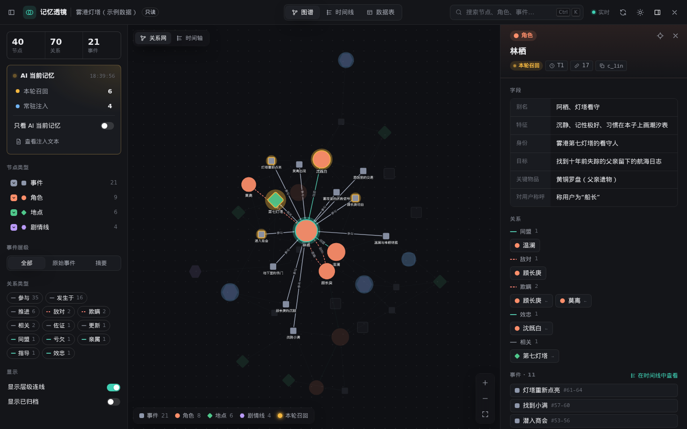
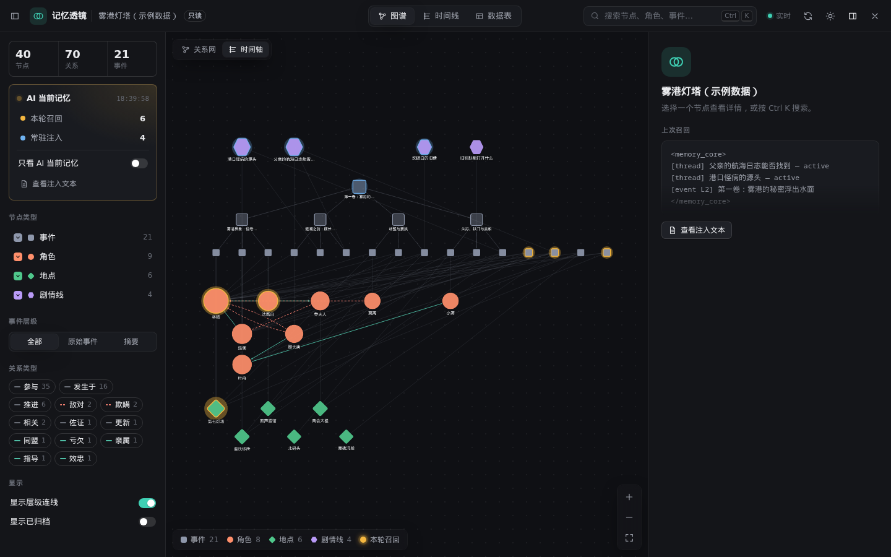
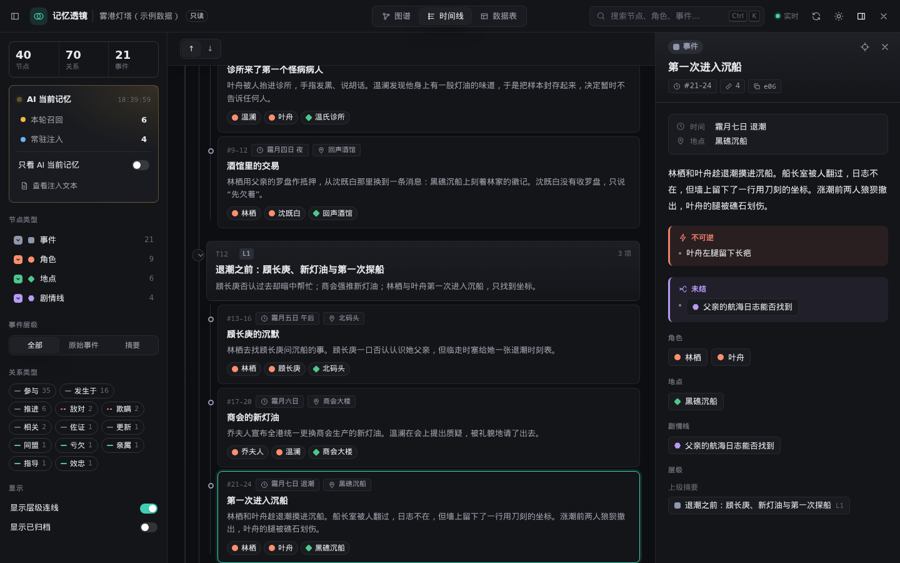
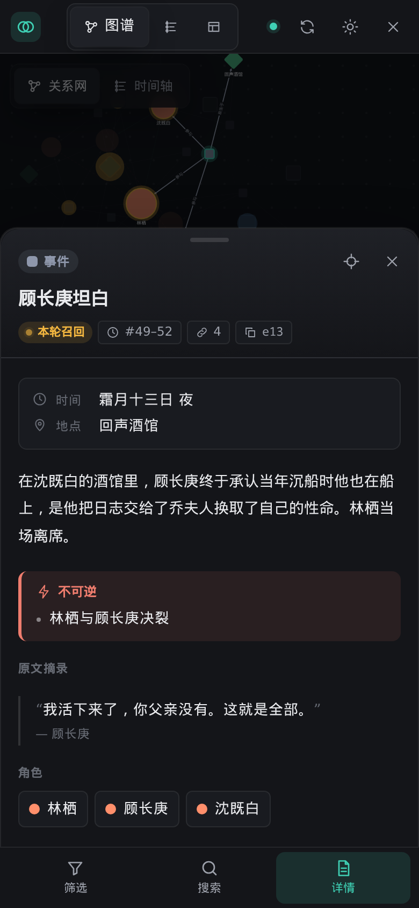

# Memory Lens · 记忆透镜

Luker 记忆图（Memory）的只读可视化工作台。从魔法棒菜单打开，全屏查看 AI 记住了什么、正在用哪些记忆。



## 功能

- **图谱**：关系网 / 时间轴两种布局；悬停或选中时聚焦相关节点；本轮召回的节点发琥珀色光，常驻注入为蓝色。
- **时间线**：摘要层级作为可折叠章节，事件带时间、地点和相关角色；可只看某个角色的经历。
- **数据表**：按节点类型分表，可排序；手机上自动变卡片。
- **详情**：事件摘要拆成时间、地点、正文、不可逆、未结（可跳转剧情线）、原文摘录；角色与地点显示字段和分组关系。
- **搜索**：`Ctrl/⌘ K` 或 `/`。`1` `2` `3` 切视图，`[` `]` 开关侧栏，`Esc` 逐级退出。
- 记忆变化、召回更新、切换聊天时自动刷新。明暗主题，电脑与手机布局。

只读。需要修改时点顶栏「在原生面板中编辑」。

## 安装

1. Luker → 扩展 → 安装扩展
2. 粘贴 `https://github.com/xzhouzhou758/memory-lens`
3. 刷新页面，确认已启用 **Memory**（记忆图）扩展
4. 魔法棒菜单 → **记忆透镜**

更新：扩展面板中点更新即可（已开启自动检查）。

## 截图

| 时间轴布局 | 时间线 | 手机 |
| --- | --- | --- |
|  |  |  |

截图使用的是虚构示例数据。

## 开发

```bash
npm test          # 单元测试（Node ≥ 20，无依赖）
npm run preview   # http://127.0.0.1:4173 示例数据预览
```

预览需要 Luker 自带的 Cytoscape：放在 Luker 的 `third-party` 目录下运行会自动找到，否则用 `LUKER_DIR=/path/to/Luker` 或 `--cytoscape <文件>` 指定。

## 兼容性

使用 `getExtensionApi('memory-graph')` 公开接口，另外按 URL 导入记忆图自带的只读接口 `getMemoryGraphReadApi`（公开接口没有列出全部节点的方法）。在 Luker 2.8.0 上验证。若 Luker 调整了该模块路径，界面会提示无法读取数据而不会影响聊天。

## 许可证

[AGPL-3.0-or-later](LICENSE)。运行时会导入 Luker（AGPL-3.0）的模块。
